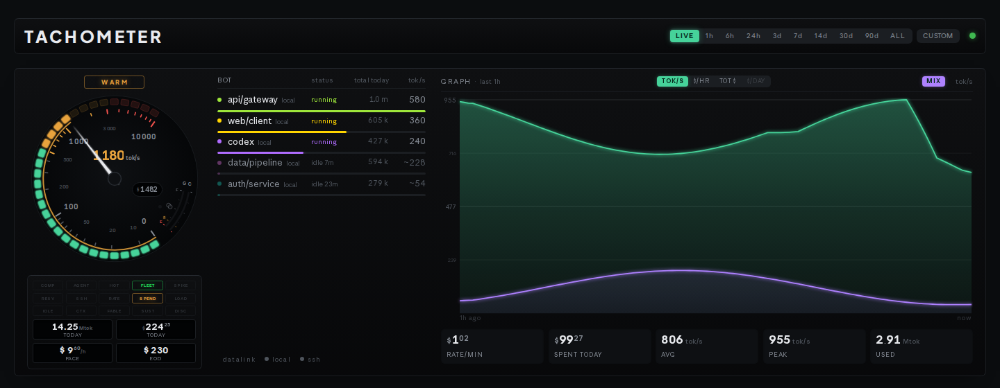
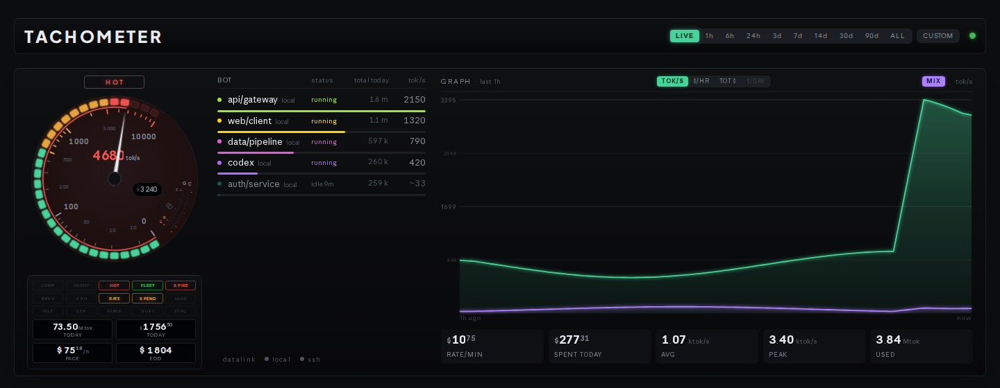

# tachometer

A live instrument panel for what Claude Code is costing you.

It reads the transcripts Claude Code already writes to disk. No proxy, no API key, no instrumentation, nothing to sign up for. If you use Claude Code, the input already exists.



```bash
git clone https://github.com/jeffbai996/tachometer
cd tachometer
python -m venv venv && venv/bin/pip install -e .
venv/bin/tachometer          # http://localhost:8710
```

## Why an instrument and not a table of numbers

A number tells you what happened. An instrument tells you what is happening.

You can glance at a dial and see whether something is running away right now, faster than you can read a figure and compare it with one you remember. The gauge, the lamps and the burn curve are the point. The numbers underneath are available anywhere.



## What it shows

- **The dial:** live token velocity across every session it can see, with a redline. The needle has ballistics and a decay curve, so a burst reads as a burst, and a stopped session winds down instead of dropping straight to zero.
- **The annunciators:** lamps for conditions you want to know about without reading anything:
  - a session compacting
  - a spike well above the running average
  - a burn rate past your threshold
  - a link that stopped answering

  They warm and cool like panel lamps instead of switching, so movement catches the eye at the edge of vision. Each lamp names its threshold on hover.
- **The roster:** each session with its state, tokens today and current rate, so you can see which session a runaway belongs to. Hovering a row shows its model and context size.
- **The graph:** token velocity, dollar burn, cumulative spend or daily spend, over windows from an hour to 90 days. `MIX` splits the curve into stacked bands by vendor, which tells you which subscription the burn belongs to without a second chart.

The panel was carved out of a larger fleet dashboard. The reserve arcs (weekly quota left) and the remote-link lamps need quota and remote-host data this standalone server does not collect, so they stay idle.

## Usage

```bash
tachometer [--host 127.0.0.1] [--port 8710] [--doctor]
```

`--doctor` prints the config directory it resolved, how many transcripts and turns it found, the estimated cost, and every model it saw. It flags any model with no rate configured. When the panel shows nothing, the cause is usually a config directory somewhere non-default, and this says so in one line.

## Configuration

Written to `~/.config/tachometer/config.toml` on first run:

```toml
# Claude Code's own config directory; transcripts live in <config_dir>/projects.
# CLAUDE_CONFIG_DIR overrides this if it is set.
config_dir = "~/.claude"

# USD per million tokens, [input, output]. Published list prices go stale, so
# edit freely and add your own tiers. Matched against the model id by
# substring, longest key first, so "opus" covers every Opus release while an
# "opus-4-8" entry would override just that one.
[rates]
opus   = [5.0, 25.0]
sonnet = [3.0, 15.0]
haiku  = [1.0, 5.0]

# Cache reads bill at a fraction of the input rate; writes at a premium.
cache_read_multiplier  = 0.10
cache_write_multiplier = 1.25
```

A model with no rate is counted at $0 and named by `--doctor`. It is never folded into the total at a guessed price.

The dollar figures are a local estimate from token counts and the rates above, computed the same way as Claude Code's own `/usage`. On a subscription they are not a bill. They are what the same work would have cost through the API, which is the number that tells you whether a workflow was worth its tokens.

State lives in `$XDG_DATA_HOME/tachometer/` (default `~/.local/share/tachometer/`; `TACHOMETER_DATA_DIR` moves it). It holds the sample cache `token_rate.db` and `usage_ledger.json`.

## Requirements and tests

Python 3.11+ and Flask. The panel is a single HTML file with no build step.

```bash
pip install pytest
python -m pytest tests
```

`docs/shoot_hero.py` renders the panel headless with Playwright, if you want a screenshot of your own.

## License

MIT.
