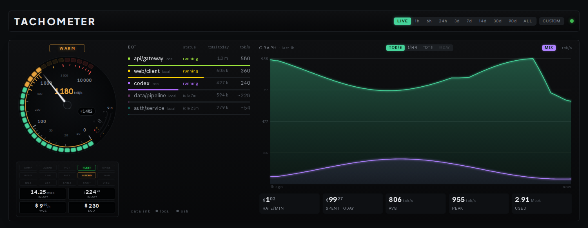
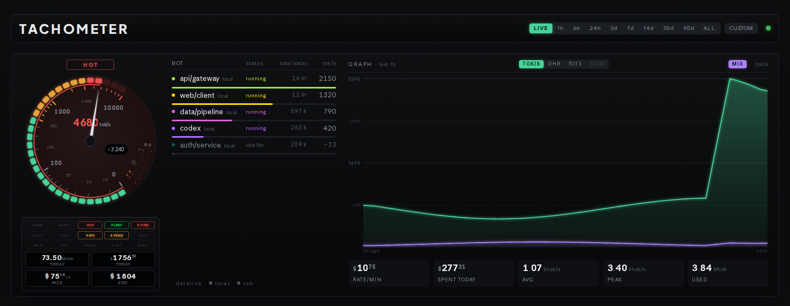

# tachometer

A live dial for what Claude Code is costing you. It reads the transcripts Claude Code already writes to disk, so there is no proxy to set up and no API key to hand over.



## Why a dial

A dial shows whether something is running away right now. You see it at a glance, without reading a figure and comparing it with one you remember.



## What it shows

**The dial** adds up token velocity across every project. The scale is logarithmic, so a quiet chat and a burst of parallel agents both move the needle. Claude Code records usage when a message finishes, so a minute of work arrives as one jump. The needle averages over the last 15 seconds to turn that jump into a steady reading. When a project goes quiet, its reading holds for 45 seconds and then fades to zero over the next 45. Past the redline the whole face turns red.

**The lamps** stay dark until their condition is true: burn past the redline, a spike at twice the recent average, two or more projects burning at once. They warm up and cool down like bulbs instead of switching. Hover a lamp to read what it means.

**The roster** has one row per project, with its state, tokens today and current rate. When something runs away, you can see whose it is.

**The graph** plots token velocity, dollar burn, or spend added up over the window. Windows run from one hour to seven days, which is how long the sample store keeps data.

The panel was cut from a larger dashboard, and some parts have nothing to read here. The quota arcs, the SSH lamp and the lamps for compaction and context size need data this server does not send, so they stay dark. The daily-spend view and the windows past seven days read a ledger this server never writes, so they stay empty.

## Install

Python 3.11 or newer.

```bash
git clone https://github.com/jeffbai996/tachometer
cd tachometer
python -m venv venv && venv/bin/pip install -e .
venv/bin/tachometer
```

Then open http://localhost:8710.

## Usage

```
tachometer [--host 127.0.0.1] [--port 8710] [--doctor]
```

If the panel is empty, run `--doctor`. The usual cause is a Claude Code config directory in a non-default place. `--doctor` prints where it looked, how many transcripts and turns it found, the estimated cost, and each model it saw. A model with no rate is marked `NO RATE`.

## Configuration

The config file is written to `~/.config/tachometer/config.toml` on first run:

```toml
# Transcripts are in <config_dir>/projects. CLAUDE_CONFIG_DIR overrides this.
config_dir = "~/.claude"

# USD per million tokens, [input, output].
[rates]
opus   = [5.0, 25.0]
sonnet = [3.0, 15.0]
haiku  = [1.0, 5.0]

# Cache reads bill at a fraction of the input rate; writes at a premium.
cache_read_multiplier  = 0.10
cache_write_multiplier = 1.25
```

List prices go stale, so edit the rates and add your own. A rate key is matched against the model id as a substring, longest key first. `opus` covers every Opus release, and an `opus-4-8` entry overrides it for that one model.

A model with no rate is counted at $0 and named by `--doctor`. It is never priced at a guess, because a plausible wrong total is worse than a visible gap.

The dollar figure is an estimate from token counts and these rates. On a subscription it is not a bill. It is what the same work would have cost through the API.

The sample store, `token_rate.db`, lives in `$XDG_DATA_HOME/tachometer/`, which is `~/.local/share/tachometer/` by default. It only caches recent samples. Deleting it costs you the recent graph history.

## Tests

```bash
pip install pytest
python -m pytest tests
```

`docs/shoot_hero.py` takes a screenshot of a running panel with Playwright.

## License

MIT.
